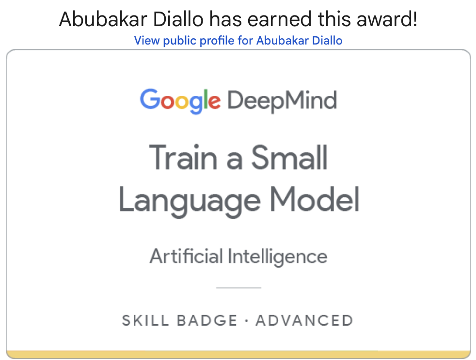
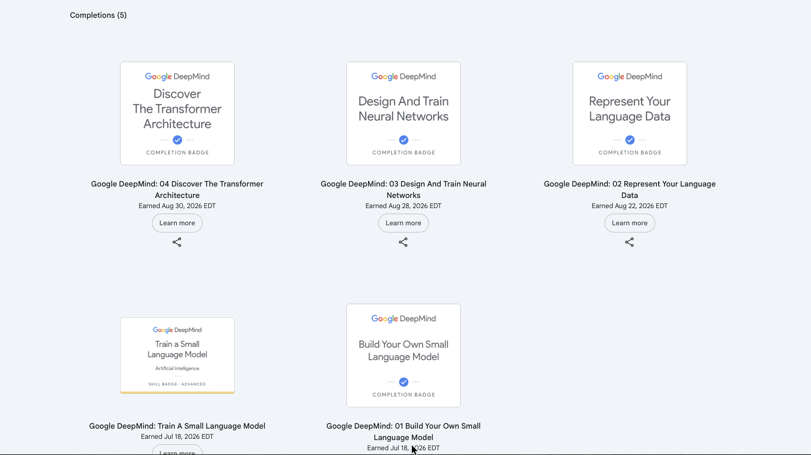
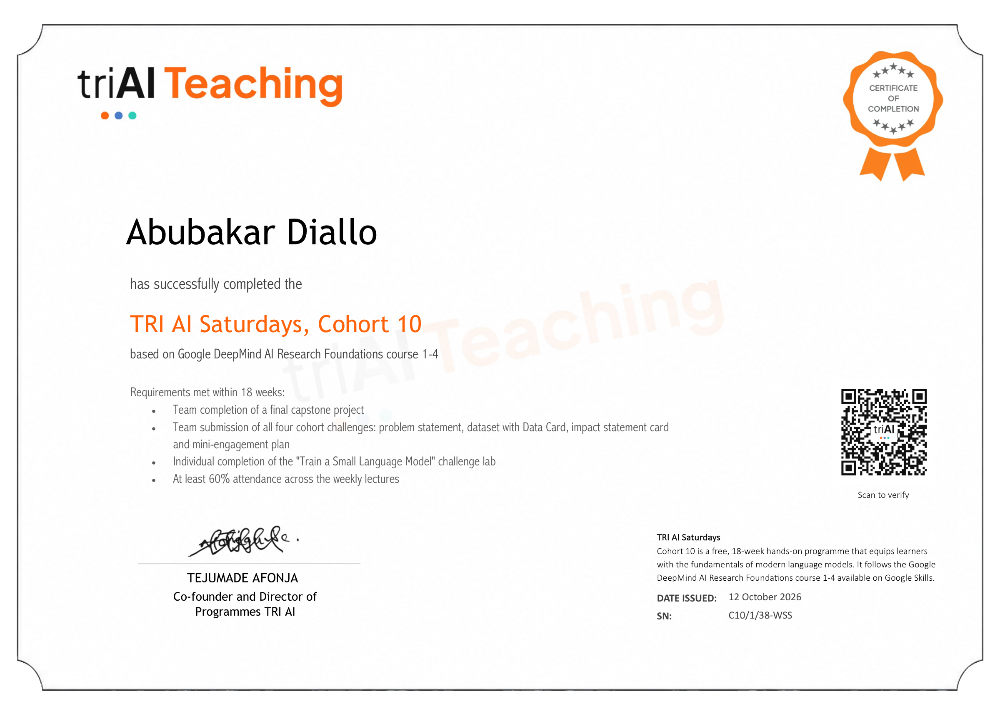

# Small Language Model — Arabic

Character-level language modelling for Arabic: a tokenizer, an n-gram text generator, and the data pipeline that prepares Arabic stories for training a transformer.

This is my solution to the **"Train a Small Language Model"** challenge lab from **Google DeepMind's AI Research Foundations** curriculum, which I completed through **TRI AI Saturdays, Cohort 10** — an 18-week programme run by TRI AI on top of the Google DeepMind courses. I built it in the Google Skills lab environment, passed the graded checks, and earned the skill badge and the cohort certificate shown below.

  

**Verify:** [my Google Skills public profile](https://www.skills.google/public_profiles/5a4ab743-9e82-4a2e-bc97-b76aa5ca3ecd)

## The scenario

Cymbal Chat, a small language-modelling startup, wants to add Arabic. Arabic attaches prefixes and suffixes directly to words — كتاب (*a book*) becomes كتابي (*my book*) or كتابه (*his book*) — so character-based models can work better than word-based ones. The lab explores that first step on a dataset of 200 short children's stories in Arabic.

## What I built

The notebook is [gdm_challenge_lab.ipynb](gdm_challenge_lab.ipynb). The lab supplies the scaffolding (text cleaning, n-gram counting, the vocabulary class); the parts below are the ones I wrote.

| Task | What it does | My code |
|------|--------------|---------|
| 2. Character tokenizer | Splits Arabic text into single-character tokens and joins them back without loss | `SimpleArabicCharacterTokenizer.character_tokenize`, `join_text` |
| 3. N-gram text generator | Extends a prompt one character at a time from a 4-gram model, with `random` or `greedy` sampling and a fallback to the overall distribution for unseen contexts | `generate_text_from_ngram_model` |
| 4a. Sequence segmentation | Cuts a long token sequence into overlapping windows that fit the model's context length | `segment_encoded_sequence` |
| 4b. Training pairs | Encodes and segments the whole dataset, pads it, and builds `inputs` and `targets` shifted by one position | `create_training_sequences` |

### Results from the run

- Tokenizer round-trips the first story line exactly: text → characters → identical text.
- The 4-gram model continues the prompt `يوم واحد` ("one day") with 15 new characters.
- A 50-token sequence segmented with `max_length=16`, `n_overlap=4` gives four windows, each starting with the last four tokens of the one before.
- With `context_length=256` and `n_overlap=8`, the 200 stories become **630 training sequences**: `inputs` and `targets` both of shape `(630, 256)`.

The notebook stops at the prepared data. The n-gram model is the baseline; the `(inputs, targets)` arrays are what a character-level transformer would be trained on next.

## Running it

The notebook was written for the Google Skills lab runtime. It needs `keras`, `numpy` and `pandas`, and it downloads the dataset itself.

The first cells authenticate to Google Cloud and set up a Cloud Logging client, and each task ends with a `logger.info(...)` call. Those exist only so the lab can grade the work. Outside the lab, skip the `gcloud auth` and logging setup cells and remove the `logger.info` lines.

## Credentials

### Google DeepMind — AI Research Foundations

All five items are listed on [my Google Skills profile](https://www.skills.google/public_profiles/5a4ab743-9e82-4a2e-bc97-b76aa5ca3ecd).

| Credential | Type | Earned |
|------------|------|--------|
| Train a Small Language Model | Skill badge, Advanced | 18 Jul 2026 |
| 01 Build Your Own Small Language Model | Completion badge | 18 Jul 2026 |
| 02 Represent Your Language Data | Completion badge | 22 Aug 2026 |
| 03 Design And Train Neural Networks | Completion badge | 28 Aug 2026 |
| 04 Discover The Transformer Architecture | Completion badge | 30 Aug 2026 |

### TRI AI Saturdays, Cohort 10

Certificate of completion, issued 12 October 2026, serial number `C10/1/38-WSS`. The programme follows Google DeepMind AI Research Foundations courses 1–4. Requirements met within 18 weeks:

- Team completion of a final capstone project
- Team submission of all four cohort challenges: problem statement, dataset with Data Card, impact statement card and mini-engagement plan
- Individual completion of the "Train a Small Language Model" challenge lab — this repository
- At least 60% attendance across the weekly lectures

[Open the certificate as a PDF](assets/TRI_AI_Certificate_Abubakar_Diallo.pdf)

## Attribution

The lab notebook, its scaffolding code and the Arabic stories dataset are from Google DeepMind's [AI Research Foundations](https://github.com/google-deepmind/ai-foundations) and are subject to the licence and terms in that repository. The completed task code is mine.

Reference cited by the lab: Mohamed, M. and Al-Azani, S. (2025). [Enhancing Arabic NLP Tasks through Character-Level Models and Data Augmentation](https://aclanthology.org/2025.coling-main.186.pdf). COLING 2025.
