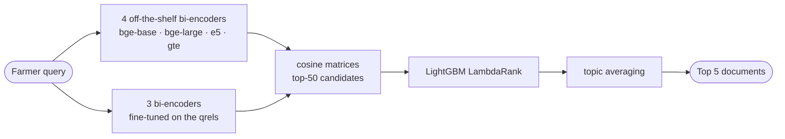

# TRI AI Saturdays, Cohort 10 — Google DeepMind AI Research Foundations

All of my work from **TRI AI Saturdays, Cohort 10**, an 18-week programme run by TRI AI that follows Google DeepMind's AI Research Foundations courses 1–4. The programme has two graded pieces of work, and this repository holds both:

| Folder | What it is | Type | Result |
|--------|------------|------|--------|
| [Donga/](Donga/) | Retrieval system for the Kaggle competition *Agricultural Extension RAG: Smart Retrieval for Farmers* | Team capstone | **4th place**, nDCG@5 0.92795 public / 0.92594 private |
| [Build-your-Model/](Build-your-Model/) | Character-level language modelling for Arabic: the "Train a Small Language Model" challenge lab | Individual lab | Passed, skill badge earned |

I completed the programme and received the certificate of completion on 12 October 2026 (serial number `C10/1/38-WSS`).

[](Build-your-Model/assets/TRI_AI_Certificate_Abubakar_Diallo.pdf)

## 1. Donga — Agricultural Extension RAG (team capstone)

**The task.** Given a farmer's question, rank the 5 most relevant documents out of a corpus of 695 agricultural factsheets (crop diseases, pests, nutrient deficiencies, soil, fertiliser, climate). The metric is nDCG@5. The organisers' TF-IDF baseline scores 0.551.

**What we built.** A three-stage retrieval pipeline:



1. **Fine-tuned encoders.** Three `bge` models fine-tuned on the competition's relevance judgements with `MultipleNegativesRankingLoss`, using hard negatives mined from the base model's own top-ranked mistakes. These fine-tunes carried most of the gain.
2. **LambdaRank fusion.** A LightGBM ranker over per-candidate features from all seven encoders: raw cosine, rank, per-query z-score, margin to best, BM25, and crop and country match.
3. **Topic averaging.** Queries that share a topic phrase should retrieve the same documents, so their score rows are averaged.

**How the score moved.**

| Submission | Public leaderboard |
|---|---|
| TF-IDF baseline (organisers) | 0.55100 |
| bge-base dense retrieval | 0.82640 |
| 4-encoder blend + LightGBM LambdaRank | 0.86954 |
| + bge-base fine-tuned on the qrels | 0.91880 |
| + bge-large fine-tuned, hard negatives, 2 seeds | 0.92734 |
| **7-encoder ensemble, candidate depth K=50 (submitted)** | **0.92795** |

**What I learned from it.**

- Train and test topics are disjoint (0 of 305 topic phrases overlap), so nothing keyed to a specific crop or disease can generalise.
- Our local cross-validation was inflated, because the fine-tuned encoders had already seen the held-out queries. We stopped trusting it and judged every change on a topic-grouped holdout and on the leaderboard, with ablations.
- Several ideas made the model worse and were left out: synthetic queries, cross-encoder reranking, and stripping the query template. Each is recorded with its numbers in [Donga/doc/experiments.md](Donga/doc/experiments.md).

**Run it.** No Kaggle account or GPU is needed; the dataset and the fine-tuned embeddings are committed.

```bash
cd Donga
pip install -r requirements.txt
python scripts/ltr.py submit        # writes submission.csv
```

**Cohort challenges.** The four written deliverables required by the programme are in [Donga/doc/](Donga/doc/): [problem statement](Donga/doc/problem_statement.pdf), [data card](Donga/doc/data_card.pdf), [impact statement](Donga/doc/impact_statement_card.pdf) and [stakeholder engagement plan](Donga/doc/stakeholder_engagement.pdf).

**Team.** Abubakar Diallo ([@Dialloni](https://github.com/Dialloni)): modelling, retrieval pipeline, fine-tuning, experiments. Dilrabo Khidirova ([@iftihorbekd](https://github.com/iftihorbekd)): problem framing, data card, impact and stakeholder analysis. Mentor: Seun Ajayi.

Full write-up: [Donga/README.md](Donga/README.md).

## 2. Build your Model — Small Language Model for Arabic (individual lab)

**The task.** The "Train a Small Language Model" challenge lab from Google DeepMind's AI Research Foundations. The scenario is a startup adding Arabic to its language model. Arabic attaches prefixes and suffixes directly to words (كتاب, *a book*, becomes كتابي, *my book*), so character-based models can work better than word-based ones. The dataset is 200 short children's stories in Arabic.

**What I built.** The lab supplies the scaffolding; I wrote the parts below in [gdm_challenge_lab.ipynb](Build-your-Model/gdm_challenge_lab.ipynb).

| Task | What it does |
|------|--------------|
| Character tokenizer | Splits Arabic text into single-character tokens and joins them back without loss |
| N-gram text generator | Extends a prompt one character at a time from a 4-gram model, with random or greedy sampling and a fallback for unseen contexts |
| Sequence segmentation | Cuts a long token sequence into overlapping windows that fit the model's context length |
| Training pairs | Encodes, segments and pads the whole dataset, then builds `inputs` and `targets` shifted by one position |

**Results.**

- The tokenizer round-trips text exactly: text → characters → identical text.
- The 4-gram model continues the prompt `يوم واحد` ("one day") with 15 new characters.
- With a context length of 256 and an overlap of 8, the 200 stories become **630 training sequences**, with `inputs` and `targets` both of shape `(630, 256)`.

The notebook stops at the prepared data: the n-gram model is the baseline, and the `(inputs, targets)` arrays are what a character-level transformer would be trained on next.

<p align="center">
  
</p>

Full write-up: [Build-your-Model/README.md](Build-your-Model/README.md).

## Credentials

### Google DeepMind — AI Research Foundations

All five are listed on [my Google Skills public profile](https://www.skills.google/public_profiles/5a4ab743-9e82-4a2e-bc97-b76aa5ca3ecd).

| Credential | Type | Earned |
|------------|------|--------|
| Train a Small Language Model | Skill badge, Advanced | 18 Jul 2026 |
| 01 Build Your Own Small Language Model | Completion badge | 18 Jul 2026 |
| 02 Represent Your Language Data | Completion badge | 22 Aug 2026 |
| 03 Design And Train Neural Networks | Completion badge | 28 Aug 2026 |
| 04 Discover The Transformer Architecture | Completion badge | 30 Aug 2026 |

### TRI AI Saturdays, Cohort 10

Certificate of completion ([PDF](Build-your-Model/assets/TRI_AI_Certificate_Abubakar_Diallo.pdf)). The requirements, and where each one is met in this repository:

| Requirement | Where |
|-------------|-------|
| Team completion of a final capstone project | [Donga/](Donga/) |
| Team submission of all four cohort challenges | [Donga/doc/](Donga/doc/) |
| Individual completion of the "Train a Small Language Model" challenge lab | [Build-your-Model/](Build-your-Model/) |
| At least 60% attendance across the weekly lectures | Confirmed by the certificate |

## Repository layout

    Tri-AI-GoogleDeepMind/
    ├── README.md                  this file
    ├── Donga/                     team capstone: agricultural retrieval
    │   ├── README.md
    │   ├── scripts/               pipeline, fine-tuning, experiments
    │   ├── src/                   retrieval, fusion, nDCG@5
    │   ├── notebooks/             Colab fine-tuning notebooks
    │   ├── data/                  competition CSVs
    │   ├── doc/                   cohort challenge PDFs, experiment log
    │   └── submission.csv         the scored file
    └── Build-your-Model/          individual lab: Arabic language model
        ├── README.md
        ├── gdm_challenge_lab.ipynb
        └── assets/                badge, certificate, profile screenshot

Each project was first published in its own repository, which keeps the full commit history: [C10-team-donga](https://github.com/Dialloni/C10-team-donga) and [Small-language-model-ARABIC](https://github.com/Dialloni/Small-language-model-ARABIC).

## Attribution

- The Donga dataset is from the Kaggle competition [Agricultural Extension RAG: Smart Retrieval for Farmers](https://www.kaggle.com/competitions/agricultural-extension-rag-smart-retrieval-for-farmers), used as issued.
- The lab notebook, its scaffolding code and the Arabic stories dataset are from Google DeepMind's [AI Research Foundations](https://github.com/google-deepmind/ai-foundations) and are subject to the licence and terms in that repository. The completed task code is mine.
